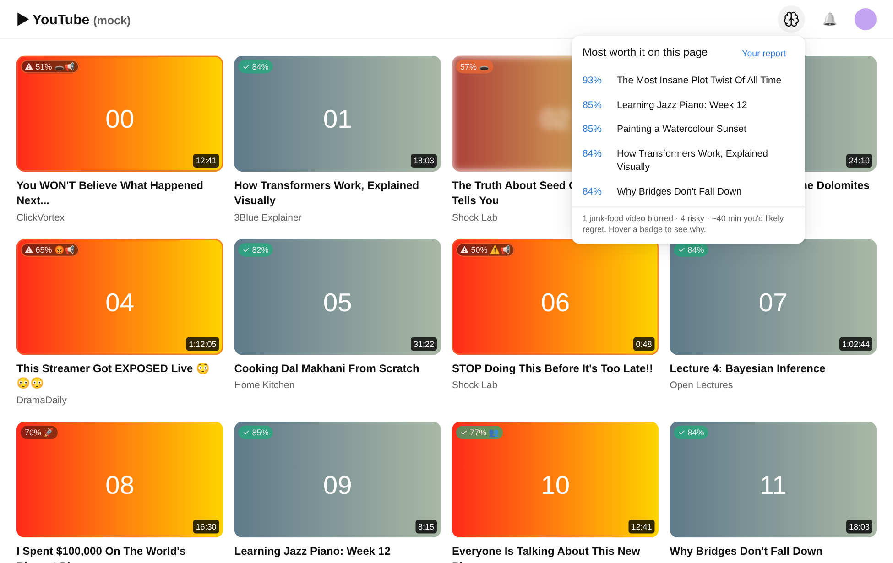

# Worth It?

**A Chrome extension that shows how YouTube hooks your brain, and learns the difference between what you click and what you actually enjoy.**



## The idea

Neuroscientists Kent Berridge and Terry Robinson showed that **wanting** (the dopamine-driven pull toward something) and **liking** (actually enjoying it) run on separate brain systems. That's why you can keep clicking on things that don't make you happy.

YouTube's recommender learns from what you *click*, which is wanting. Worth It? also measures what you *like* by asking one quick question after each video: **"Was that worth it?"** Then it re-ranks your feed for liking.

## What it does

| | Feature | The psychology behind it |
|---|---|---|
| 🔍 | **Spots the hook** in every title and thumbnail, and labels it: curiosity gap, outrage, fear, FOMO, social proof, hype, shouting, loud thumbnail | Information-gap theory (Loewenstein), negativity bias, scarcity and social proof (Cialdini), incentive salience |
| ❓ | **Asks "Was that worth it?"** (1–5) after you watch, plus an optional mood check. Two more answers for videos you didn't finish: **✂️ Got what I needed** (counts as worth it) and **⏸ Finishing later** (learns nothing now, asks again when you're done) | Experience sampling: rating in the moment, not from memory |
| ↩️ | **One entry per video**: watching a video again adds to the same entry, and rating it again replaces your earlier answer | |
| 🧠 | **Learns *your* wanting vs liking**: which hooks make you click, and which ones actually pay off, per hook *and per channel* | Two small personal models: P(click) and P(glad you watched) |
| ⏱️ | **Learns even when you don't rate**: finishing most of a video counts as a weak "liked it". Leaving in the first 20% counts as a weak "didn't" only if you don't come back within 3 days. Leaving halfway counts as nothing | Behavioural signal to complement self-report |
| 🍔 | **Flags junk food, only with evidence**: once *your* ratings show a channel or hook pulls hard but rarely pays off, it gets an orange badge and a blurred thumbnail (hover to reveal). On day 1, hooks are only labelled, never judged | Lowering cue reactivity: a blurred cue has less pull |
| ⭐ | **Suggests worth-it picks** from the current page, in a small panel | Ranks by `liking − λ · max(0, wanting − liking)` |
| 🌙 | **Notices your vulnerable moments**: late night and deep in a session | Fatigue weakens self-control while the cue's pull stays strong |
| 📊 | **"Your Brain on YouTube" report**: your personal triggers, worst hours, rabbit holes, moods and channels | |


*The report above uses the built-in demo data (a simulated viewer). Yours fills in as you watch and rate.*

## Install (2 minutes)

1. Download or clone this folder.
2. In Chrome, open `chrome://extensions`.
3. Turn on **Developer mode** (top right).
4. Click **Load unpacked** and pick the `worth-it` folder.
5. Pin the 🧠 icon, then open YouTube.

To use it, browse normally. Every video shows its **worth-it %**; hover the badge to see *why*. After a video, answer "Was that worth it?" (it takes one second). Open the report from the toolbar icon. To see what it looks like before you have data, click **Load demo data** at the bottom of the report.

## Privacy

Everything stays in your browser (`chrome.storage.local`). There are no accounts, servers or analytics. The only network request the extension makes itself is downloading video thumbnails from YouTube's image server, to measure how loud they are. You can export or delete your data from the report page at any time.

## How it works

```
src/hooks.js       hook detector: title patterns + thumbnail colour analysis
src/model.js       personal model: two online logistic regressions with research-informed priors
src/content.js     runs on youtube.com: badges, blur, picks panel, click and watch tracking, rating prompt
src/background.js  single writer for storage; analyses thumbnails
src/store.js       storage and running statistics
report/            "Your Brain on YouTube"
popup/             toolbar popup: switches, strictness slider, today's stats
```

- **Wanting** is learned from impressions. Each video card that stays on screen for at least 1 s counts as "shown", and the one you open counts as "clicked".
- **Liking** is learned from your 1–5 ratings, where 4–5 counts as worth it. For videos you don't rate, it learns more weakly (half weight) from how much you watched:
  - **Watched 70% or more:** counts at once as "liked it".
  - **Left in the first 20%:** waits 3 days. If you come back to the video in that time, it's treated as "watching the rest later" and never counts against it.
  - **"⏸ Finishing later":** never counts against the video, even if you don't come back.
  - **Watching again:** each video has one entry. Watch time adds up across visits, and if you're asked again, the prompt shows your last answer and a new one replaces it (the model only re-learns if your opinion changed).
- **Packaging vs track record:** each channel gets its own learned offset on top of the hook weights. A channel with clickbait-style titles that you consistently enjoy ends up "✓ worth it", and its hooks are shown only as small emoji. The same hooks from a channel you regret get flagged.
- **Getting started:** both models start from priors that say hooks pull harder but pay off less, and that late nights and long sessions make it worse. These priors move the *worth it %*, but they never trigger a junk-food verdict on their own. That takes at least 2 ratings of the channel or 5 ratings of videos with that hook, plus a below-60% chance you'll enjoy it. Hover any badge to see what it's based on.
- **The ranking score** comes from the [KuaiRand research](../README.md) in the parent folder. That study showed, on 1.19M real impressions, that ranking this way cuts regretted clicks by about 10%.

## Develop and test

```bash
node --test test/hooks.test.js test/model.test.js test/store.test.js
```

```bash
python test/serve.py
```

The first command runs the unit tests: hook detection, the model, the demo generator, and storage flows (return visits, "finishing later", "got what I needed"). The second starts a mock YouTube at http://localhost:8765 that runs the real extension code end to end. `/report/report.html?demo=1` shows the report with demo data.

## Limitations

- **English titles only.** Hook detection is rule-based, so it's fast, private and explainable, but it misses subtle or non-English hooks.
- **"Loud thumbnail" is a colour heuristic** (saturation, vivid pixels, contrast). It doesn't detect faces or arrows.
- **YouTube changes its page layout often.** The selectors cover the current and previous layouts, but they may need updating.
- **Shorts aren't tracked yet.**
- **Early on, the priors do most of the work** for the worth-it %. Expect around 30 rated videos before the report says much about *you*.
- **It judges a channel's track record, not each video's content.** One great video from a channel you usually regret can still get flagged. Hover to unblur.
- **It's self-tracking, not a clinical tool.** Ratings are your own judgement, and the patterns are correlations.
