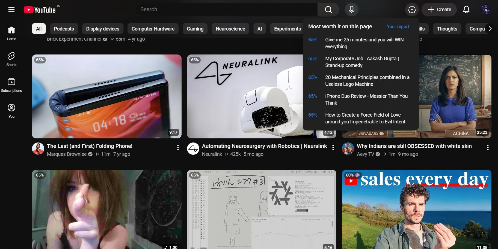
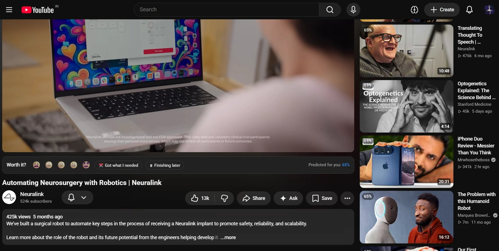
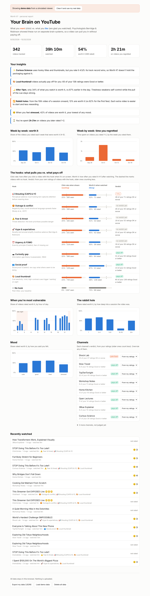

# Worth It?

**A Chrome extension that shows how YouTube hooks your brain, and learns the difference between what you click and what you actually enjoy.**



*A fresh install: with no ratings yet, the worth-it % comes from research-based starting points, so most videos look alike. It becomes yours as you rate.*

## The idea

Neuroscientists Kent Berridge and Terry Robinson showed that **wanting** (the dopamine-driven pull toward something) and **liking** (actually enjoying it) run on separate brain systems. That's why you can keep clicking on things that don't make you happy.

YouTube's recommender learns from what you *click*, which is wanting. Worth It? also measures what you *like*, with one quick question in a slim bar under every video: **"Was that worth it?"** Then it flags the junk food on your feed and suggests what's actually worth your time.

## What it does

| | Feature | The psychology behind it |
|---|---|---|
| 🔍 | **Spots the hook** in every title and thumbnail, and labels it: curiosity gap, outrage, fear, FOMO, social proof, hype, shouting, loud thumbnail | Information-gap theory (Loewenstein), negativity bias, scarcity and social proof (Cialdini), incentive salience |
| ❓ | **"Worth it?" right under the video**: a slim bar beneath the player with five faces (1–5), your predicted worth-it %, and an optional mood check. Rate any time, change it any time; no popups unless you turn them on. Two more answers for videos you didn't finish: **✂️ Got what I needed** (counts as worth it) and **⏸ Finishing later** (learns nothing until you finish) | Experience sampling: rating in the moment, not from memory |
| ↩️ | **One entry per video**: watching a video again adds to the same entry, and rating it again replaces your earlier answer | |
| 🧠 | **Learns *your* wanting vs liking**: which hooks make you click, and which ones actually pay off, per hook *and per channel* | Two small personal models: P(click) and P(glad you watched) |
| ⏱️ | **Learns even when you don't rate**: finishing most of a video counts as a weak "liked it". Leaving in the first 20% counts as a weak "didn't" only if you don't come back within 3 days. Leaving halfway counts as nothing. **Rewatching** a video you'd finished counts as a strong "liked it"; **bouncing** (leaving a video within 30 seconds) as a small "didn't" | Behavioural signal to complement self-report |
| 🍔 | **Flags junk food from your track record**: three levels, ⚠ *risky* (orange outline), 🍔 *junk food* (blurred, hover to reveal) and ✓ *worth it*, judged from how you actually rated that channel or hook, only once the evidence is confident. Your own rating of a video always wins, and long videos you'd likely regret are judged more strictly. On day 1, hooks are only labelled, never judged | Lowering cue reactivity: a blurred cue has less pull |
| ⭐ | **Suggests worth-it picks** from the current page: click the brain icon in YouTube's top bar (next to the bell) | Ranks by `liking − λ · max(0, wanting − liking)` |
| 🌙 | **Notices your vulnerable moments**: late night and deep in a session | Fatigue weakens self-control while the cue's pull stays strong |
| 📊 | **"Your Brain on YouTube" report**: week-by-week worth-it % and regretted time, your personal triggers, worst hours, rabbit holes, moods, and every channel's verdict (which you can overrule) | |





*The report above uses the built-in demo data (a simulated viewer). Yours fills in as you watch and rate.*

## Install (2 minutes)

1. Download or clone this folder.
2. In Chrome, open `chrome://extensions`.
3. Turn on **Developer mode** (top right).
4. Click **Load unpacked** and pick the `worth-it` folder.
5. Pin the 🧠 icon, then open YouTube.

To use it, browse normally. Every video shows its **worth-it %**; hover the badge to see *why*, or click it to overrule the verdict for that channel. Under the video you're watching, tap a face to say whether it was worth it (it takes one second; the bar lights up when the video ends). The brain icon in YouTube's top bar lists the most worth-it videos on the page. Prefer a popup too? Pick one in the toolbar popup, where you also set **how strict** it is about junk food. Open the report from the toolbar icon. To see what it looks like before you have data, click **Load demo data** at the bottom of the report.

## Privacy

Everything stays in your browser (`chrome.storage.local`). There are no accounts, servers or analytics. The only network request the extension makes itself is downloading video thumbnails from YouTube's image server, to measure how loud they are. You can export or delete your data from the report page at any time.

## How it works

```
src/hooks.js       hook detector: title patterns + thumbnail colour analysis
src/model.js       personal model: two online logistic regressions with research-informed priors
src/content.js     runs on youtube.com: badges, blur, top-bar picks button, rating bar, click and watch tracking
src/background.js  single writer for storage; analyses thumbnails
src/store.js       storage and running statistics
report/            "Your Brain on YouTube"
popup/             toolbar popup: switches, strictness slider, today's stats
```

- **Wanting** is learned from impressions. Each video card that stays on screen for at least 1 s counts as "shown", and the one you open counts as "clicked".
- **Liking** is learned from your 1–5 ratings, where 4–5 counts as worth it. For videos you don't rate, it learns more weakly (half weight) from how much you watched:
  - **Watched 70% or more:** counts at once as "liked it".
  - **Left in the first 20%:** waits 3 days. If you come back to the video in that time, it's treated as "watching the rest later" and never counts against it.
  - **"⏸ Finishing later":** never counts against the video, even if you don't come back.
  - **Rewatching** a video you'd already finished (for at least a minute) teaches a strong "liked it". **Bouncing**, leaving a video of 2+ minutes within 30 seconds on a first visit, teaches a small "didn't". Neither counts toward the junk-food track record, which is only your ratings.
  - **Watching again:** each video has one entry. Watch time adds up across visits, the bar shows your last answer, and a new one replaces it (the model only re-learns if your opinion changed).
- **Packaging vs track record:** each channel gets its own learned offset on top of the hook weights. A channel with clickbait-style titles that you consistently enjoy ends up "✓ worth it", and its hooks are shown only as small emoji. The same hooks from a channel you regret get flagged.
- **Getting started:** both models start from priors that say hooks pull harder but pay off less, and that late nights and long sessions make it worse. These priors move the *worth it %*, but they never trigger a verdict on their own.
- **Verdicts come from your track record:** each channel and each hook keeps a count of how you rated it. A level is only given when the evidence is confident (a Beta posterior: at least 70% sure that under half of its videos are worth it to you for ⚠ *risky*, 85% for 🍔 *junk food*, 85% sure that over half are for ✓ *worth it*). In practice: 1 bad rating is nothing, 2 make a channel risky, 3 of 3 or 4 of 5 make it junk food. Leaving a level takes clearly better evidence than entering it, so one rating doesn't flip it back and forth.
  - **No hook needed:** a plain-titled channel you keep regretting is flagged too.
  - **The channel decides first;** a hook's record (across every channel) only decides for channels without one, and never blurs a channel you've enjoyed before.
  - **Your own rating wins:** a video you rated 😩 or 😕 is always junk food, one you rated 🙂 or 🤩 never is.
  - **Minutes matter:** a risky video you'd likely regret 30+ minutes of counts as junk food; junk food under 2 minutes is only risky. Badges and the picks menu show the likely regretted minutes.
  - **How strict** (toolbar popup) moves these thresholds: *gentle* waits for 3 bad ratings (risky) and 4 (junk food), and counts a long video as junk food from an hour of likely regret; *medium* is the default above; *strict* flags after 1 bad rating (risky) and 2 (junk food), and from 15 minutes. Changing it re-judges everything at once.
  - **Older ratings fade:** a rating counts half as much after 90 days, a quarter after 180, so a channel that changed gets re-judged, and a verdict nobody backs up any more expires on its own.
  - **Your call wins:** click any badge to see why, and choose "isn't junk for me" or "always flag" for its channel (or change it under *Channels* in the report). Only your rating of a specific video outranks it.
  - Hover any badge to see what it's based on, e.g. "4 of your 5 ratings of DramaDaily were OK or worse."
- **The picks ranking** (`liking − λ · max(0, wanting − liking)`) comes from an offline study on the KuaiRand dataset, which showed, on 1.19M real impressions, that ranking this way cuts regretted clicks by about 10%.

## Develop and test

```bash
node --test test/hooks.test.js test/model.test.js test/store.test.js
```

```bash
python test/serve.py
```

The first command runs the unit tests: hook detection, both models, the track record (confidence levels, fading, overrides, strictness), the demo generator, and storage flows (re-watches and re-ratings, rewatches and bounces, "finishing later", "got what I needed").

The second starts a local test page at http://localhost:8765 that imitates YouTube's page structure and runs the real extension code end to end. It reproduces the quirks of the real site that caused bugs: the previous video's title lingering after you navigate, earlier pages kept hidden in the page, the miniplayer, and a video ending without its "ended" event. Useful pages:

- `/` the home feed; click any video for its watch page
- `/?shot=1` demo data with the picks menu open
- `/report/report.html?demo=1` the report with demo data
- `/popup/popup.html` the toolbar popup

## Limitations

- **English titles only.** Hook detection is rule-based, so it's fast, private and explainable, but it misses subtle or non-English hooks.
- **"Loud thumbnail" is a colour heuristic** (saturation, vivid pixels, contrast). It doesn't detect faces or arrows.
- **YouTube changes its page layout often.** The selectors cover the current and previous layouts, but they may need updating. Automated tests run on the local test page, so check new behaviour on the real site too.
- **Shorts aren't tracked yet.**
- **Desktop Chrome only.** Chrome on phones doesn't run extensions, and no extension can reach the YouTube app.
- **Early on, the priors do most of the work** for the worth-it %. Expect around 30 rated videos before the report says much about *you*.
- **It judges a channel's track record, not each video's content.** One great video from a channel you usually regret can still get flagged: hover to unblur, rate it, or tell it the channel isn't junk for you.
- **It's self-tracking, not a clinical tool.** Ratings are your own judgement, and the patterns are correlations.
